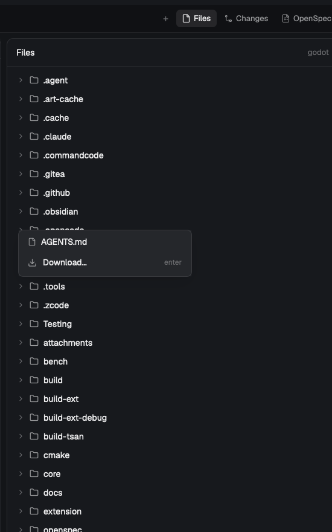

# Files extras for Herdr

Herdr's Files panel with **right-click downloads** and **Markdown previews**.
Right-click a file to save a copy to this Mac, or a folder to download it as
a zip; a space on another machine works the same way and the file is copied
back from there.

It is a fork of Herdr's shipped `files` mod, so the lazy tree, git status
marks and text preview stay exactly as they were.



## What it adds

- **Right-click a file → Download…** A save panel opens at the last folder
  you used (the first time, `~/Downloads`). The file is copied there; on a
  space on another machine it is first brought back from that machine.
- **Right-click a folder → Download as zip…** The folder is zipped where it
  lives (`zip`, or a `.tar.gz` when that machine has no `zip`) and saved
  where you choose. Symlinks stay links.
- **Markdown preview** — `.md` files render with headings, lists, tables,
  checkboxes, quotes and fenced code, drawn by the same renderer as the
  [OpenSpec mod](https://github.com/AshMcConnell/herdr-openspec), instead of
  the plain code editor.

Everything else is the shipped panel: it follows the focused pane's folder
(including a space on another machine), loads folders lazily, marks changed
files against git, and lists files with folders first.

## Install

Needs [Herdr](https://herdr.dev) (herdr-app) 0.1.16 or newer, tested on
0.1.16.

Copy `mods/files-extras/` into `~/.config/herdr-app/mods/`, then point the
Files panel in your layout at it. In a layout cloned from `main`, the
`panel-body` stack has a block with:

```json
{ "id": "files", "type": "block", "content": { "mod": "files" } }
```

change `files` to `files-extras`. Or ask your agent:

> Read ~/.config/herdr-app/AGENTS.md, then add this mod: herdr.dev/mods/AshMcConnell/herdr-files-extras

Keep the copied folder real: a symlink to a checkout outside
`~/.config/herdr-app` loads, but its icons fail to resolve and saves there do
not hot-reload.

## How downloading works

- **The save panel** is AppleScript's `choose file name` on macOS, so it
  starts in the last folder used and keeps the standard save behaviour.
  Elsewhere the mod uses Herdr's folder picker, adding ` (2)` to a name that
  is already taken. The last folder is remembered in Herdr's shared state as
  `files.download.folder`.
- **A local file** is a plain `cp`. **A file on another machine** is read
  with `wc -c`, then `dd` and `base64` in 4 MiB pieces (Herdr's `exec` output
  is capped at 8 MiB), kept as small temp files under
  `~/.config/herdr-app/data/`, and decoded here with `base64 -D`. Very large
  remote files therefore take a while.
- **A folder** is zipped on the machine it lives on (`zip -qry` from its
  parent, so the archive holds the folder itself). Without `zip`,
  `tar -czf` is used and the suggested name ends `.tar.gz`. A failed zip
  leaves no partial archive behind.
- **Remote files need a Unix-like machine** (`sh`); a Windows remote is not
  supported yet. The local machine can be macOS, Linux or Windows.

## What it runs

Like any Herdr mod it is trusted code. It runs `exec` with `sh`, `zip`,
`tar`, `base64`, `dd` and `wc`, plus `osascript` on macOS for the save
panel; on Windows it uses `powershell` (`Copy-Item`, `Compress-Archive`,
base64 decode). On a space on another machine the same commands run there
through herdr-core.

It writes only the file or archive you choose, plus temporary base64 pieces
under `~/.config/herdr-app/data/`, which it removes afterwards. It never
writes into the folder it is browsing.

## Built on

- Herdr's shipped `files` mod (Apache License 2.0) — the panel this forks.
- [herdr-openspec](https://github.com/AshMcConnell/herdr-openspec) (MIT) —
  the Markdown renderer in `md.js`.

MIT licensed; see [LICENSE](LICENSE) and [NOTICE](NOTICE).
