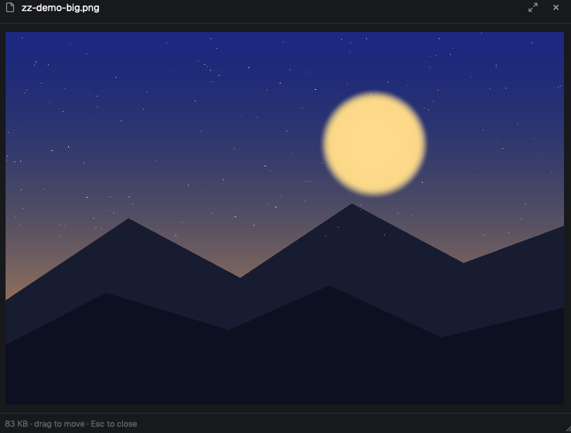

# Files extras

A Herdr mod: the app's shipped Files panel, forked and given a right-click
menu that downloads a file to this Mac (a file on another machine is brought
back from there), downloads a folder as a zip, and renames or deletes an
entry. Files and folders can be dragged in from Finder — or picked from a
native dialog — to land in the folder being browsed, even when it lives on
another machine. `.md` files preview as rendered Markdown, and an image
previews in a window. Everything else — the lazy tree, git status marks, text
preview — is the shipped panel.

## What you see

- **The panel** is a card: `background`, a 1 px `border`, radius 10, text
  13 px, clipped. Its header is 42 px tall, 14 px side padding, 8 px gap: a
  20 px **←** (only while a file is open), "Files" semibold, then the last
  path segment in 12 px `dim`, right-aligned and truncated.
- **Tree rows** are 28 px: left padding `8 + depth × 18`, right 8, gap 7,
  radius 7, `hover` background; a 12 px `dim` chevron (or a 12 px spacer for
  files), a 14 px `muted` file/folder icon, the name (flex 1, truncated),
  and a git mark in 11 px: `A` in `ansi2`, `D`/`U` in `ansi1`, `M` in
  `blocked`. Folders come first, then names in locale order.
- **The menu** is a 262 px pointer popup on `popover`, padded 5 px: 170 px
  tall for an entry, 202 px with the image-preview row, and 74 px on the
  tree's empty space (upload only). The header row (9 px sides, 3 top, 5
  bottom, 7 gap) has a 13 px file or folder icon in `muted`, the name
  truncated, and `on <machine>` in 11 px `dim` when the file lives elsewhere.
  The rows are 32 px: 9 px sides, 9 gap, radius 7, hover `hover`, a 14 px
  icon, the label, and an 11 px `dim` key hint. **Preview image…** with
  `enter` (images only), **Download…** for a file (**Download as zip…** for a
  folder) with `enter` — no hint when Preview has it — **Upload files…** with
  `u`, **Rename…** with `r`, **Delete…** with `d`. Enter runs the default
  (preview for an image, download otherwise); Esc or a press outside closes
  the menu. Rename turns the rows into a name field; Delete turns them into a
  confirmation.
- **Preview**: a selected text file replaces the tree. The header shows its
  name; body text is a read-only editor at 12 px with the theme's syntax
  colours, or the Markdown view for `.md`. A NUL byte reads as "Binary file ·
  no text preview"; unreadable files say so. An image does not use this view:
  clicking it opens the image window and the tree stays as it was.
- **Image preview** is a movable window that opens filled to the work area: a
  card like the panel's. Its 42 px header has a 14 px file icon, the name
  truncated, `on <machine>` when needed, a fill/compact button, and a 22 px
  ✕. The body is 12 px padding with the picture centred and scaled to fit;
  the 28 px footer says `<size> · drag to move · Esc to close`. Drag the
  header to move it and the bottom-right grip to resize it; the header button
  toggles between filled and 760 × 580. Clicking an image in the tree or a
  search result opens it, and the menu's **Preview image…** does the same.
  Esc or ✕ closes it, and the temp copy goes with it.

## The panel

- It follows the **focused pane**: `location()` returns a pinned
  `props.folder` if given, else the focused pane's `cwd`, the focused
  terminal's `cwd`, or the active space's `folder`. `on` is the space's
  `machine`; when a layout terminal block is focused (no pane), it is the
  machine prefix of its terminal address, if any. `props.file` opens one
  file relative to that folder, once.
- A folder is listed with one `sh -c` loop over `"$1"/* "$1"/.[!.]*`
  (skipping `.git`), or PowerShell `Get-ChildItem` on Windows — local or
  another machine, where a missing `sh` falls back to PowerShell. 500 per
  folder, 5,000 total.
- Folders expand lazily: one level loads on open, and only then. A 10 s
  timer refreshes; locally `watchFolder` does too. Git marks come from
  `git status --porcelain=v1 -z --no-renames --untracked-files=all` with
  `--no-optional-locks` and fsmonitor off, so it writes nothing under
  `.git`.
- The preview uses `readTextFile`, capped at 400,000 characters, with a
  language map for the editor.

## Downloading

- **The menu** is the same mod opened again:
  `openOverlay({ mod: "files-extras", kind: "popup", width: 262, height: 74,
  props: { menu: { source, name, dir, image, on } } })` (106 px tall for an
  image). The copy's `init` returns as soon as `props().menu` exists, focuses
  a handle for Enter/Esc, and renders only the menu.
- **Choosing** closes the popup, then downloads in a plain async function
  (no `cx`), so closing the popup cannot cancel it. Success and failure are
  toasts with the saved path (and size for a file from another machine).
- **Where to save**: macOS runs `osascript` with
  `choose file name with prompt … default name … default location (POSIX
  file …)`. Candidate start folders are the remembered
  `files.download.folder` (shared state), `~/Downloads`, then home. A user
  cancel is silent; any other failure falls back to Herdr's `pickFolder`,
  which has no start folder, so the name is made unique there
  (`test -e`/`Test-Path`; `foo (2).txt`).
- **A file here** is `cp "$1" "$2"` (`Copy-Item` on Windows). **A file on
  another machine** is `wc -c`, then `dd if="$1" bs="$2" skip="$3" count=1`
  and `base64 | tr -d "\n"` for each 4 MiB piece. `exec` output is capped at
  8 MiB, so the piece is 4 MiB − 1: a multiple of 3, which means no piece
  ends in `=` inside the stream. The base64 is split into 1,000,000-character
  parts written by `writeTextFile` (its limit is 1 MiB) under
  `~/.config/herdr-app/data/files-download-<time>-<rand>/part-00000.b64`.
  One decode then writes the file: `cat "$dir"/part-*.b64 | base64 -D >
  dest` on macOS, `base64 -d` on Linux, `[IO.File]::WriteAllBytes` on
  Windows. The temp folder goes in a `finally`.
- **A folder** is zipped where it lives: locally
  `rm -f dest; cd src/.. && zip -qry dest name`, or `tar -czf` when the
  machine has no `zip`. On another machine it is zipped under `mktemp -d`,
  copied back like a file, then the temp folder is removed. The suggested
  name is `<folder>.zip` or `.tar.gz`, matching which tool exists.
- Refuse to save a folder archive inside that folder, or to copy a file onto
  itself. A failed local zip removes its partial archive.

## Uploading

- **Two ways in.** Dropping files or folders from outside the app onto the
  tree: a folder row takes them into that folder (its `on_drop` stops
  propagation), the tree itself takes them at the root — including over the
  empty "No files" state; file rows are not targets, like Finder. Or
  right-click → **Upload files…**: the row's folder when it is a folder, its
  parent when it is a file. The picker cannot take folders — they arrive by
  dragging.
- **The picker** is `osascript` with `choose file … with multiple selections
  allowed` on macOS (POSIX paths, one per line; a cancel is silent) and
  PowerShell's `OpenFileDialog` with `Multiselect` (`-STA`, NUL-joined)
  elsewhere. It runs in the popup copy, which stays open until the batch
  settles, exactly like a download.
- **Names**: one listing of the target's names (a glob loop like the tree's,
  NUL-separated), then `name (2)`, `name (3)`, … in JS against that set plus
  names earlier items of the same batch claimed — so a 50-file drop on
  another machine is one listing, not 50 `test -e` round trips, and two
  dropped `logo.png` files arrive as `logo.png` and `logo (2).png`. The
  original is never replaced.
- **A file here** is `cp "$1" "$2"` (`Copy-Item -Force` on Windows). **A
  file on another machine** goes through `hc file write --on <machine>`:
  a local `sh` (or `cmd /c` on Windows — cmd's `<` redirect is byte-safe,
  PowerShell's pipes are not) feeds the file to hc's stdin, and hc makes
  missing folders on the way. It prints `{"bytes":N}`, which becomes the
  toast's size. Verified: 5 MiB of random bytes in 0.4 s, SHA-256 equal.
- **A folder to another machine** is one archive: `zip -qry` here when the
  far end has `unzip` (probed once; Windows uses `Compress-Archive`), else
  `tar -czf` (tar ships with macOS, Linux and Windows 10's System32). The
  archive goes under `~/.config/herdr-app/data/files-upload-<time>-<rand>/`,
  is pushed as a single file to a `mktemp -d` on the machine, extracted into
  the target there (`unzip -qo`, `tar -xzf`), and both temp folders go in
  `finally`s. Without `unzip` or `tar` at the far end, folders fail with a
  clear toast while files still arrive.
- **Skips and toasts**: an item that is the target, inside it, or already
  sitting in it is skipped — dropping something the tree already holds
  cannot recurse onto itself. One batch at a time (`uploading`); a second
  drop during one is ignored. Toasts: start (except a single local file,
  which finishes before one could matter), success with count and size, one
  error per failed item (the rest still arrive), "Already here" when
  everything was skipped. Afterward the target folder is expanded if it was
  collapsed (the folder watch only refreshes folders already expanded), or
  the root reloads.

## Image previews

- **Which files**: the extension is one of png, jpg/jpeg, gif, webp, bmp, ico,
  tif/tiff or svg (`image.js`). Clicking the row opens the window; the menu
  gets the extra Preview row (Enter previews).
- **Opening**: `openPicture` is the one path, used by `show` for a click (tree
  or search) and by the menu's Preview row:
  `openOverlay({ mod: "files-extras", kind: "window", key:
  "files-extras-image", at: previewAt(), props: { image: { source, name, on }
  } })`. It is a `window`, not a popup: it drags by any press the mod does not
  stop, stays open until closed, and replaces the previous preview by its key.
  Its `init` focuses a handle for Esc and calls `loadPicture`.
- **Fill and resize**: the card's own `w(this.w).h(this.h)` is the window's
  content size, so the host follows it. `init` sets `this.w/h` to the filled
  size; the bottom-right grip's `on_mouse_move` changes them and the header
  button toggles between that size and 760 × 580. The host anchors content
  growth at `at`, so the gripper moves the corner rather than the card's
  centre.
- **Sizing units**: `window.viewport_size()` (the global GPUI window, not
  `herdr`'s platform object) is in window px, and so is `at`; overlay
  `width`/`height` are zoomed layout px. `init` divides the viewport budget
  by `settings().zoom`; the grip divides pointer deltas by the same zoom.
- **Why a copy**: `image()` resolves a path from `~/.config/herdr-app`, not
  from the file that asked; an absolute path draws nothing. `stageImage`
  copies the picture to `data/files-preview-<time>-<rand>/image.<ext>`, which
  `image()` then draws. A local file is `cp` (`Copy-Item` on Windows); a file
  on another machine takes the same `dd`/`base64` pieces as a download, then
  the local decode.
- **Limits**: `wc -c` (or `(Get-Item).Length`) reads the size first: missing
  says "This file is no longer available", empty says "This image is empty",
  over 32 MB names the limit. A staging failure shows the command's error.
- **Picture size**: the picture is `image(path).max_w(this.w - 24).max_h(this.h
  - 42 - 28 - 24)`, which scales it down and keeps its shape without enlarging
  it. The card size is therefore the budget, so a big window shows a big
  picture rather than clipping a fixed one.
- **Cleanup**: `close(cx)` removes the temp folder, including a stage the
  copy is still filling: `stageImage`'s `onDir` records the folder as soon as
  it exists, and `close` removes it by name.

## The files

- `main.js` — the panel (from the shipped `files` mod), the menu, the image
  preview, and the `download(menu)` / `uploadMenu(menu)` orchestrations,
  which call the helpers below.
- `download.js` — the download work, with every host call passed in as an
  argument: `chooseDestination`, `hasZip`, `downloadFile`, `downloadFolder`,
  `uniquePath`, `addSuffix`, `sizeText`, `fileSize`, `tempFolder`,
  `cleanTemp`, and the `extractor` probe uploads reuse. It imports nothing,
  so a plain Node script can exercise the shell commands with a fake `exec`.
- `upload.js` — the upload work, same shape: `describe` (what dropped paths
  are), `listNames`/`uniqueNames`, `uploadFile`, `uploadFolder`,
  `pickUploads`, and the `uploadItems` batch driver. Imports only
  `download.js`, so it runs under plain Node against a real `exec` — the
  remote paths included, through `hc exec --on`.
- `image.js` — image extensions, the 32 MB limit, and `stageImage`, which
  copies a picture into the app folder and returns its app-relative path.
- `md.js` — the Markdown renderer, adapted from
  [herdr-openspec](https://github.com/AshMcConnell/herdr-openspec) (MIT),
  plus GFM tables. It uses the fixed Tokyo Night palette.
- `download.svg`, `upload.svg`, `rename.svg`, `trash.svg`, `preview.svg`,
  `expand.svg`, `collapse.svg` and `resize.svg` — the lucide download, upload,
  pencil, trash and eye glyphs, the maximize/minimize pair, and the corner
  grip; chevron, file and folder icons are the shipped ones.

## Watch out

- `image()` takes an app-relative path: an absolute path draws nothing. That is
  why previews are staged under `data/files-preview-*` first.
- A window overlay sized by its content follows `w()`/`h()` changes; one
  opened with `width`/`height` does not, so the preview deliberately leaves
  both out. The host anchors growth at `at`, which keeps the resize grip's
  pointer math stable.
- Overlay `width`/`height` are zoomed layout px while `at` and
  `viewport_size()` are window px; divide by `settings().zoom`. On this Mac
  the zoom was 1.1, so a 760 px card rendered about 836 px wide.
- A window does not take the keyboard when it opens; the preview focuses its
  own handle in `init` so Esc works. A popup still takes it.
- `writeTextFile` stops at 1 MiB and `exec` at 8 MiB; the part and chunk
  sizes are set from those limits. Bigger limits allow bigger pieces.
- `exec` rejects for a machine it does not know, so the remote path has to
  be tested by wrapping `exec` to drop `on` and running locally.
- A popup takes the keyboard. Do not snapshot the focused folder inside the
  menu copy; pass `source` in its props.
- `herdr-app check` proves load and first render only. The menu is a
  separate copy with its own props, so check it with a throwaway copy whose
  `props().menu` is fixed.
- The Windows local branches (`Copy-Item`, `Compress-Archive`, the cmd
  redirect, the OpenFileDialog) are written but unproven; a Windows remote
  is not supported — it needs a PowerShell branch for reading, sizing and
  zipping.
- Row `on_drop` relies on `cx.stop_propagation()` keeping the tree's own
  drop handler quiet, the way the right-click handler does; the
  `uploading` guard is the backstop, so the worst case is a drop landing
  at the root instead of the folder row.
- `hc` has to be on the PATH `exec` sees; it is what herdr-core itself
  runs, so it is there in practice.
- The save-panel start folder is macOS-only; Herdr's own picker elsewhere
  cannot be given one.

## Done when

- `herdr-app check mods/files-extras` passes.
- Right-clicking a file opens the menu; Download opens a save panel at
  `~/Downloads` first, then the last folder used; the saved bytes match
  (`cmp`).
- Right-clicking a folder saves a zip that unzips to the same tree.
- Clicking an image opens the preview window filled to the work area; a
  right-click → Preview image… does the same. Drag the header to move it, the
  bottom-right grip to resize it, and the header button to shrink it to
  760 × 580 and back. Esc and ✕ close it, and its `data/files-preview-*`
  folder is gone afterwards. A file over 32 MB says so.
- On a space on another machine, all of these still work and the bytes match.
- A cancel in the save panel does nothing; a failure shows an error toast.
- Dropping files onto the tree lands them in the root, and onto a folder
  row inside it; a name already there arrives as `name (2).ext`, the
  original untouched.
- Upload files… picks several files into the row's folder (the parent, for
  a file row); a cancel copies nothing.
- Dropping a folder copies it whole, here and to another machine, with no
  archive or temp folder left behind (`ls /var/folders/*/*/T/tmp.*` count
  unchanged on the remote).
- Dropping a file already in the browsed folder toasts "Already here" and
  copies nothing; a failed item toasts its reason and the rest arrive.
- The upload harness (a Node script with a real `exec`, `on` through
  `hc exec --on`) passes: byte-identical remote files, extracted remote
  folders, conflict renames, in-batch splits, skips.
